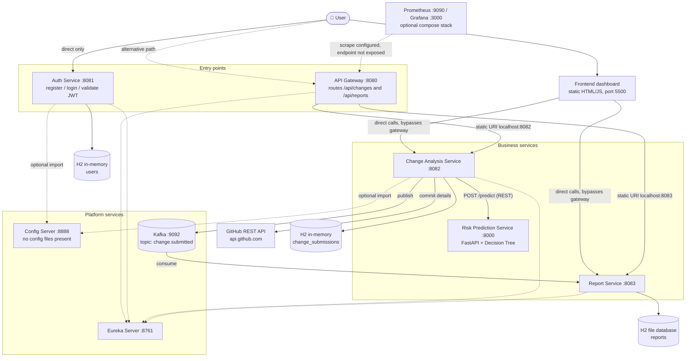
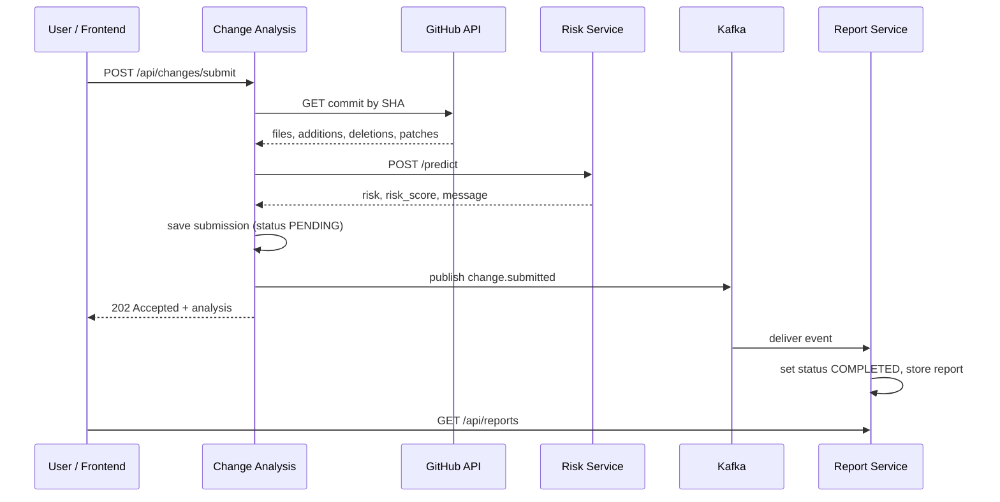

<h1 align="center">ImpactFlow — Cloud-Native Software Change Impact & Risk Prediction Platform</h1>

<p align="center">
  A microservices prototype that takes a GitHub commit, extracts simple change metrics, classifies the change as
  <b>LOW / MEDIUM / HIGH</b> risk with a small machine-learning model, and stores the result as a report.
</p>

<p align="center">
  <b>Stack:</b> Java · Spring Boot · Spring Cloud (Eureka, Config, Gateway) · Apache Kafka · Python · FastAPI · scikit-learn · H2 · HTML/CSS/JavaScript · Docker · Kubernetes · Helm · GitHub Actions
</p>

> **Status: academic prototype.** This README was written from an inspection of the repository at commit `579953c`.
> Section 3 shows exactly which parts are implemented, partial, or only configured. Please read it before a demo.
> Anything marked **(not verified)** was not executed while this document was prepared.

---

## 📑 Table of Contents

1. [Project Overview](#overview)
2. [Architecture](#architecture)
3. [Implementation Status](#status)
4. [Key Features](#features)
5. [Risk Prediction Methodology](#methodology)
6. [Event-Driven Architecture](#events)
7. [Technology Stack](#stack)
8. [Repository Structure](#structure)
9. [Prerequisites](#prerequisites)
10. [Local Setup and Execution](#setup)
11. [Configuration and Environment Variables](#config)
12. [API Documentation and Examples](#api)
13. [Database and Data Flow](#database)
14. [Docker, Kubernetes, and Helm](#deploy)
15. [CI/CD and DevSecOps](#cicd)
16. [Testing and Validation](#testing)
17. [Troubleshooting](#troubleshooting)
18. [Security Considerations](#security)
19. [Limitations and Future Enhancements](#limitations)
20. [Academic Viva Questions](#viva)
21. [Author and License](#author)

---

<a id="overview"></a>
## 📖 1. Project Overview

### The problem
Before a code change is merged or released, reviewers want to know how risky it is. Size, spread across files and
control-flow density are cheap signals, but reading every diff by hand does not scale.

### The approach
ImpactFlow splits that job across small services:

1. A user submits a **public GitHub repository URL and commit SHA**.
2. **Change Analysis Service** fetches the commit from the GitHub REST API and derives metrics: changed-file count, lines added, lines deleted, and a keyword-based complexity score (1–5).
3. It calls the **Risk Prediction Service** (Python/FastAPI), which returns a `LOW`/`MEDIUM`/`HIGH` label and a model-derived score.
4. The submission is saved, and a `change.submitted` event is published to **Kafka**.
5. **Report Service** consumes the event, stores a report, and exposes it through REST endpoints for the **frontend dashboard**.

Asynchronous messaging decouples report storage from the submission request. If Report Service is briefly down, Kafka retains the event until it comes back.

### Role of machine learning
A scikit-learn Decision Tree maps four numeric inputs to a risk label. It is trained on **18 hand-written synthetic samples** (see [Section 5](#methodology)). It demonstrates how an ML service plugs into a polyglot architecture; it is **not** a validated defect predictor.

### Goals vs. what is demonstrated
| Goal | Demonstrated by the code? |
|---|---|
| Analyze a commit and classify its risk | ✅ Yes (REST path, Change Analysis → Risk service) |
| Persist and display reports from Kafka events | ✅ Yes (`change.submitted` → Report Service → UI) |
| Central authentication for all APIs | ❌ No. Login/JWT issuance exists, but nothing enforces it elsewhere |
| Service discovery driving routing | ⚠️ Services register with Eureka, but the gateway uses fixed `localhost` URLs |
| Centralized configuration | ⚠️ Config Server runs but serves no config files |
| Working end-to-end deployment on Kubernetes | ⚠️ Not as written (see [Section 14](#deploy)) |
| Metrics dashboards | ❌ Prometheus/Grafana containers only; no service metrics endpoint is exposed |

---

<a id="architecture"></a>
## 🧩 2. Architecture



**How to read the diagram**

- **Solid arrows** are runtime calls verified in source. **Dotted arrows** are registration, optional configuration, or configured-but-not-working links.
- The **frontend calls Change Analysis (8082) and Report Service (8083) directly** (`ImpactFlow/impactflow-frontend/app.js`). The gateway is an alternative entry point, not the frontend's path.
- The **gateway** has two routes with hard-coded `http://localhost:…` targets. It does not use `lb://` Eureka lookups (`spring.cloud.gateway.discovery.locator.enabled=false`) and has no JWT filter.
- **Auth Service** is reachable only on its own port; the gateway has no `/api/auth` route and nothing calls Auth to validate tokens.
- **Risk prediction is a synchronous REST call**, not a Kafka message. The Risk service does not touch Kafka.
- **Config Server** is configured with `classpath:/shared`, but no such folder exists in the repository, so it serves nothing. Clients use `optional:configserver:`, so they start with local properties.
- **Prometheus/Grafana** run via a separate compose file; the scrape target for the gateway is not exposed (see [Section 3](#status)).

---

<a id="status"></a>
## ✅ 3. Implementation Status

Legend: ✅ implemented in source · ⚠️ partial / configured only · ❌ absent

| Component | Status | Evidence and caveats |
|---|---|---|
| Eureka Server | ✅ | `eureka-server/`, port 8761, standalone (does not register with itself) |
| Config Server | ⚠️ | Native profile, `classpath:/shared`; **no `shared/` resources exist**, so nothing is served. Only Auth and Change Analysis import it (as optional); the gateway disables it; Report Service doesn't use it |
| API Gateway | ⚠️ | Spring Cloud Gateway Server WebMVC; two static routes; **no authentication filter**; no `/api/auth` route |
| Auth Service | ⚠️ | Register / login / validate with BCrypt + HS256 JWT. **Tokens are not enforced by any other service.** Clients may request arbitrary roles at registration |
| Change Analysis Service | ✅ | Fetches commit from GitHub, calls Risk service, saves, publishes Kafka event |
| Risk Prediction Service | ✅ | FastAPI `/health`, `/predict`; Decision Tree on synthetic data |
| Report Service | ✅ | Kafka consumer, JPA persistence, REST endpoints |
| Kafka | ✅ / ⚠️ | Single-node KRaft broker in `ImpactFlow/docker-compose.yml`. Only **one** topic, `change.submitted`, is used. `change.enriched` and `risk.scored` **do not exist** in the code |
| Frontend | ⚠️ | Static dashboard (overview, submit form, report history). Hits backend ports directly. No login/JWT usage |
| Docker | ⚠️ | One Dockerfile per service (copy a prebuilt JAR; not multi-stage). Compose file contains **only Kafka**. No frontend image |
| Kubernetes / Helm | ⚠️ | Chart deploys 7 workloads, but only the gateway receives Eureka/Config env vars; no Kafka; **cluster wiring is incomplete** ([Section 14](#deploy)) |
| GitHub Actions | ✅ | Java build matrix and Python compile check (latest run status **not verified**) |
| Prometheus / Grafana | ⚠️ | Compose stack + `prometheus.yml`. Gateway scrape path `/actuator/prometheus` is not exposed and no Micrometer Prometheus dependency is in any `pom.xml`. Grafana has no provisioned datasource/dashboard |
| Tests | ⚠️ | Six Spring `contextLoads` smoke tests; no unit/integration tests; no Python test suite |

---

<a id="features"></a>
## ✨ 4. Key Features

| Feature | What it does | Where |
|---|---|---|
| **Microservices architecture** | Six Spring Boot services plus one Python service, each independently buildable | repository root, `ImpactFlow/risk-prediction-service/` |
| **Service discovery** | Gateway, Auth, Change Analysis and Report Service register with Eureka; dashboard at `:8761` | `eureka-server/`, each client's `application.properties` |
| **Centralized configuration** | Config Server runs in native mode; clients import it optionally. *Currently serves no files* | `config-server/` |
| **API Gateway routing** | `/api/changes/**` → `:8082`, `/api/reports/**` → `:8083` | `api-gateway/src/main/resources/application.properties` |
| **JWT authentication** | BCrypt-hashed users; HS256 tokens with `sub` and `roles` claims; 24 h default expiry (`jwt.expiration=86400000`) | `auth-service/…/AuthController.java`, `JwtTokenProvider.java` |
| **Software change analysis** | Validates the GitHub URL (`https://github.com/<owner>/<repo>`) and SHA (7–40 hex chars); reads files, additions, deletions and patches | `change-analysis-service/…/GitHubService.java` |
| **Kafka event publishing** | Publishes `ChangeSubmittedEvent` to `change.submitted`, keyed by submission ID | `KafkaProducerService.java` |
| **ML risk classification** | Decision Tree returns label + score | `ImpactFlow/risk-prediction-service/main.py` |
| **Report generation and retrieval** | Consumes events, stores JSON in H2, exposes list / summary / by-id | `report-service/` |
| **Interactive frontend** | Overview metrics, submit form, searchable report history with detail panel | `ImpactFlow/impactflow-frontend/` |
| **Containerization** | Dockerfiles for all seven services | `*/Dockerfile` |
| **Kubernetes + Helm** | Chart with Deployments/Services for each component (see caveats) | `ImpactFlow/helm/impactflow/` |
| **Automated CI** | `mvn clean verify` per Java service; Python dependency install and `py_compile` | `.github/workflows/` |
| **Monitoring (scaffold)** | Prometheus and Grafana containers | `ImpactFlow/monitoring/` |

---

<a id="methodology"></a>
## 🤖 5. Risk Prediction Methodology

Source: `ImpactFlow/risk-prediction-service/main.py` and `evaluate_model.py`.

### Model
- `sklearn.tree.DecisionTreeClassifier(max_depth=4, random_state=42)` — **depth 4**, not 5.
- The service loads `model.joblib` if present and valid (needs `predict`, `predict_proba`, and 4 input features). Otherwise it **retrains from the dataset embedded in `main.py`** and overwrites the file.
- The Docker image copies only `main.py` (not `model.joblib`), so **a container always trains its own model at first start** from the embedded data.

### Input features (in order)
| Feature | Type / validation | How Change Analysis produces it |
|---|---|---|
| `changed_files` | integer ≥ 0 | Number of files in the GitHub commit response |
| `lines_added` | integer ≥ 0 | Sum of `additions` across files |
| `lines_deleted` | integer ≥ 0 | Sum of `deletions` across files |
| `complexity` | integer 1–5 | Starts at 1, +1 per regex match of `if`, `else if`, `for`, `while`, `case`, `catch`, `&&`, `\|\|`, `?` in each file's raw patch text; capped at 5 |

> These differ from the candidate names `totalLocDelta`, `cyclomaticComplexity`, `fileChurnRate`, `impactedServicesCount`. **Those names do not exist in the code.** `complexity` is a keyword-count heuristic over diff text (which includes removed and context lines), **not** true cyclomatic complexity. Requests with unknown fields are rejected (`extra="forbid"`).

### Output
```json
{ "risk": "LOW | MEDIUM | HIGH", "risk_score": 0.333, "message": "..." }
```
`risk_score = Σ P(class) × rank(class) / 3` with `LOW=1, MEDIUM=2, HIGH=3`, rounded to 3 decimals, so it ranges from 0.333 to 1.0. The service's own message states that it is **not a calibrated probability of software failure**.

### Training data and evaluation
- **18 synthetic rows with hand-assigned labels** (4 LOW, 3 MEDIUM, 11 HIGH). Labels follow intuition (larger/more complex → higher risk), not observed defects.
- `evaluate_model.py` runs 3-fold stratified cross-validation on that same synthetic set. **Run during README preparation** (Python 3.12, pinned requirements): accuracy 0.944, fold accuracies 1.0 / 0.833 / 1.0. These numbers are reproducible by running the script, but with 18 synthetic rows they **do not establish real-world accuracy**, and the script itself prints that caveat.
- No real labelled defect data, calibration, or model comparison exists in the repository.

### Limitations
Tiny, imbalanced, synthetic data; labels encode the author's assumptions; four coarse features; unknown behavior outside the training range; `model.joblib` is a pickle (load only files you trust).

---

<a id="events"></a>
## 📨 6. Event-Driven Architecture

| Topic | Producer | Consumer | Status |
|---|---|---|---|
| `change.submitted` | Change Analysis Service (`KafkaProducerService`) | Report Service (`ReportKafkaConsumer`, group `report-service-group`) | ✅ Implemented |
| `change.enriched` | — | — | ❌ Not present in source |
| `risk.scored` | — | — | ❌ Not present in source |

Risk scoring happens **synchronously** before the event is published, so a separate `risk.scored` topic is not needed by the current design.



**Payload** — the serialized `ChangeSubmittedEvent`:

```json
{
  "submission": {
    "id": "<uuid>", "repoUrl": "...", "commitId": "...", "branch": "...",
    "proposedChange": "<commit message>", "submittedAt": "...", "status": "PENDING",
    "risk": "...", "riskScore": 0.0, "riskMessage": "...",
    "linesAdded": 0, "linesDeleted": 0, "complexity": 1,
    "changedFiles": ["..."]
  }
}
```

**Report lifecycle (from code):** the submission row in Change Analysis stays `PENDING` forever (nothing updates it). The Report Service copies the event's `submission` object, sets `status` to `COMPLETED`, and stores it as JSON in its own table.

**Error handling:** the consumer catches every exception and logs it to `System.err`. There is **no retry, dead-letter topic, or idempotency check**; a malformed event is dropped. Topics are auto-created by the broker (`KAFKA_AUTO_CREATE_TOPICS_ENABLE=true`).

---

<a id="stack"></a>
## 🧰 7. Technology Stack

Only items confirmed in `pom.xml`, `requirements.txt`, Dockerfiles, compose/Helm files, or workflows.

| Category | Technologies |
|---|---|
| **Backend** | Java, Spring Boot **4.1.1** (Gateway, Auth, Change Analysis, Config, Eureka) and **4.0.2** (Report Service); Spring Cloud **2025.1.3** / **2025.1.1**; Spring Web MVC, Spring Data JPA, Spring Security (Auth only), Bean Validation, Actuator; jjwt (JWT) |
| **Machine learning / Python** | Python 3.11 (CI, Docker), FastAPI 0.161.1, Uvicorn 0.54.0, NumPy 2.4.6, scikit-learn 1.9.1, joblib 1.6.0 (all pinned in `requirements.txt`). `kafka-python` is listed there but **not used** by `main.py` |
| **Messaging** | Apache Kafka 3.7.0 (`apache/kafka` image, KRaft mode, single node); Spring for Apache Kafka |
| **Databases** | H2 (in-memory for Auth and Change Analysis; file-based for Report Service). PostgreSQL JDBC driver is declared in Change Analysis but **not configured** |
| **Frontend** | Vanilla HTML, CSS, JavaScript (no build tooling or framework) |
| **Containerization** | Docker; Eclipse Temurin JRE 17/21 base images; `python:3.11-slim` |
| **Orchestration** | Kubernetes, Helm chart `impactflow` (chart 0.1.0) |
| **CI/CD** | GitHub Actions (`actions/checkout@v4`, `setup-java@v4`, `setup-python@v5`) |
| **Monitoring** | Prometheus and Grafana images (`:latest`) via compose — scaffold only |

Not present in the repository: Trivy, SonarQube, MLflow, Swagger/OpenAPI for Java services, a LICENSE file.

---

<a id="structure"></a>
## 📁 8. Repository Structure

```text
CNAD-16/
├── .github/workflows/
│   ├── java-ci.yml                  # mvn clean verify for 6 Java services
│   └── python-ci.yml                # pip install + py_compile for risk service
├── .gitignore
├── README.md
├── api-gateway/                     # Spring Cloud Gateway (WebMVC), port 8080
│   ├── Dockerfile  mvnw  mvnw.cmd  pom.xml
│   └── src/{main,test}/…            # ApiGatewayApplication, application.properties (routes)
├── auth-service/                    # Register/login/validate, JWT, port 8081
│   └── src/main/java/com/impactflow/auth/{config,controller,domain,dto,repository,security}
├── change-analysis-service/         # GitHub analysis, Kafka producer, port 8082
│   └── src/main/java/com/impactflow/analysis/{controller,domain,dto,repository,service}
├── config-server/                   # Spring Cloud Config Server (native), port 8888
├── eureka-server/                   # Service registry, port 8761
├── report-service/                  # Kafka consumer + report REST API, port 8083
│   └── src/main/java/com/impactflow/report/   # Controller, KafkaConsumer, Store, Repository, ReportData
└── ImpactFlow/
    ├── docker-compose.yml           # Kafka only
    ├── helm/impactflow/             # Helm chart (Chart.yaml, values.yaml, templates/)
    ├── impactflow-frontend/         # index.html, app.js, styles.css, README.txt, backup.js (older copy)
    ├── monitoring/                  # docker-compose.yml (Prometheus, Grafana), prometheus.yml
    └── risk-prediction-service/     # main.py, evaluate_model.py, model.joblib, requirements.txt, Dockerfile,
                                     # main.py.backup (older copy)
```

Each Java service also has `.mvn/wrapper/`, `.gitattributes` and `.gitignore`. Generated with `git ls-files`; `target/`, virtual environments and caches are not tracked.

---

<a id="prerequisites"></a>
## 📋 9. Prerequisites

| Tool | Version | Why |
|---|---|---|
| Git | any recent | Clone |
| **JDK** | **21 recommended** | `report-service/pom.xml` sets `java.version=21`; the other five declare 17. CI builds all six with JDK 21. Spring Boot 4 requires at least 17 |
| Maven | not required | Each service includes `mvnw` / `mvnw.cmd` (downloads Maven on first run) |
| Python | 3.11 (CI/Docker); 3.12 was used for the checks in this README | Risk service |
| Docker Desktop | recent | Kafka via Compose; building images |
| Minikube, kubectl, Helm 3 | recent | Only for Kubernetes (optional) |
| Internet access | — | Maven/PyPI downloads and **unauthenticated calls to `api.github.com`** |

---

<a id="setup"></a>
## 🚀 10. Local Setup and Execution (Windows Command Prompt)

Local mode runs each service as a plain process on `localhost`. This is the path the code is written for. (Kubernetes mode is separate; see [Section 14](#deploy).)

### 10.1 Clone
```bat
git clone https://github.com/NarneAmruthaLekha/CNAD-16.git
cd CNAD-16
```
Existing working copy on the author's machine: `cd /d "D:\3-1(ImpactFlow)\CNAD-16-update"`. Run all commands below from the repository root unless stated otherwise.

### 10.2 Start Kafka (Docker Compose)
```bat
cd ImpactFlow
docker compose up -d
docker compose ps
cd ..
```
Kafka listens on `localhost:9092`. The compose file defines **only Kafka**; every other service runs outside Docker in local mode.

### 10.3 Start services in dependency order
Open **one Command Prompt per service**, each from the repository root. Each is launched from its **own directory** with the Maven Wrapper.

| Order | Service | Command | Port |
|---|---|---|---|
| 1 | Eureka Server | `cd eureka-server && mvnw.cmd spring-boot:run` | 8761 |
| 2 | Config Server *(optional; serves nothing today)* | `cd config-server && mvnw.cmd spring-boot:run` | 8888 |
| 3 | Risk Prediction Service | see 10.4 | 8000 |
| 4 | Change Analysis Service | `cd change-analysis-service && mvnw.cmd spring-boot:run` | 8082 |
| 5 | Report Service | `cd report-service && mvnw.cmd spring-boot:run` | 8083 |
| 6 | Auth Service *(independent)* | `cd auth-service && mvnw.cmd spring-boot:run` | 8081 |
| 7 | API Gateway *(optional)* | `cd api-gateway && mvnw.cmd spring-boot:run` | 8080 |

The Risk service must be up before Change Analysis handles requests: its URL is **hard-coded to `http://127.0.0.1:8000`**. Change Analysis starts without Kafka running, but submissions will fail to publish.

### 10.4 Start the Risk Prediction Service (FastAPI)
```bat
cd ImpactFlow\risk-prediction-service
python -m venv .venv
.venv\Scripts\activate
python -m pip install -r requirements.txt
uvicorn main:app --host 127.0.0.1 --port 8000
```
Keep `.venv` out of Git (already ignored).

### 10.5 Start the frontend
```bat
cd ImpactFlow\impactflow-frontend
python -m http.server 5500
```
Open <http://localhost:5500>. Port **5500 matters**: Change Analysis and Report Service allow CORS only from `http://localhost:5500`.

### 10.6 Verify
```bat
curl.exe http://localhost:8000/health
curl.exe http://localhost:8082/actuator/health
curl.exe http://localhost:8083/api/reports/health
curl.exe http://localhost:8081/actuator/health
curl.exe http://localhost:8080/actuator/health
```
Then open the Eureka dashboard at <http://localhost:8761> and confirm the registered instances (`API-GATEWAY`, `AUTH-SERVICE`, `CHANGE-ANALYSIS-SERVICE`, `REPORT-SERVICE`).

| What | URL |
|---|---|
| Dashboard UI | <http://localhost:5500> |
| Risk service Swagger UI (FastAPI) | <http://localhost:8000/docs> |
| Eureka dashboard | <http://localhost:8761> |
| Report Service H2 console (enabled in config) | <http://localhost:8083/h2-console> |

There is **no Swagger/OpenAPI** for the Java services.

---

<a id="config"></a>
## 🔑 11. Configuration and Environment Variables

### Variables and overrides actually referenced

| Variable | Component | Purpose | Required? |
|---|---|---|---|
| `GITHUB_TOKEN` | Change Analysis | Bound to `github.token` in `application.properties`, but **no code reads it**, so it currently has no effect; calls to GitHub are unauthenticated (low rate limit) | No |
| `SPRING_CONFIG_IMPORT` | Gateway (Helm) | Set to `optional:configserver:http://config-server:8888` in the Helm Deployment | Set by chart |
| `EUREKA_CLIENT_SERVICEURL_DEFAULTZONE` | Gateway (Helm) | Set to `http://eureka-server:8761/eureka/` in the Helm Deployment | Set by chart |
| `KAFKA_NODE_ID`, `KAFKA_PROCESS_ROLES`, `KAFKA_LISTENERS`, `KAFKA_ADVERTISED_LISTENERS`, `KAFKA_CONTROLLER_*`, `KAFKA_*_REPLICATION_FACTOR`, `KAFKA_AUTO_CREATE_TOPICS_ENABLE`, `CLUSTER_ID` | Kafka container | Single-node KRaft setup; advertised listener is `localhost:9092` | Set in compose |

### Properties you will likely change
Spring Boot lets environment variables override properties (e.g. `JWT_SECRET` → `jwt.secret`). That is standard Spring behavior and was **not tested** here.

| Property | File | Default | Notes |
|---|---|---|---|
| `jwt.secret` | `auth-service/…/application.properties` | **a real-looking key is committed** | Replace it with your own ≥ 32-byte secret ([Section 18](#security)) |
| `jwt.expiration` | Auth | `86400000` ms | 24 h |
| `spring.kafka.bootstrap-servers` | Change Analysis, Report | `localhost:9092` | |
| `eureka.client.service-url.defaultZone` | gateway, auth, analysis, report | `http://localhost:8761/eureka/` | |
| `spring.datasource.url` | auth, analysis, report | H2 (see [Section 13](#database)) | |
| *(hard-coded)* risk URL | `RiskPredictionService.java` | `http://127.0.0.1:8000` | No property — a code change is required to point elsewhere |
| *(hard-coded)* gateway routes | gateway `application.properties` | `localhost:8082` / `localhost:8083` | Edit the file |

### Keeping secrets out of Git
```bat
set JWT_SECRET=<a-long-random-value-you-generate>
set GITHUB_TOKEN=<optional-personal-access-token>
cd auth-service
mvnw.cmd spring-boot:run
```
Set variables in the shell that launches each service (or in your IDE run configuration). Never commit `.env` files, tokens, or keys; `.gitignore` already excludes `.env`. For Kubernetes, use a `Secret` rather than values in `values.yaml`.

---

<a id="api"></a>
## 🔌 12. API Documentation and Examples

Windows `curl.exe` quoting is used below. Responses with generated IDs or runtime data are **illustrative**.

### Summary

| Method | Path | Service (port) | Purpose | Auth |
|---|---|---|---|---|
| POST | `/api/auth/register` | Auth (8081) | Create a user | None |
| POST | `/api/auth/login` | Auth (8081) | Get a JWT | None |
| GET | `/api/auth/validate?token=…` | Auth (8081) | Check a JWT | None |
| POST | `/api/changes/submit` | Change Analysis (8082), also via gateway (8080) | Analyze a commit | **None enforced** |
| GET | `/api/changes/{id}` | Change Analysis (8082), also via gateway | Fetch a stored submission | **None enforced** |
| GET | `/api/reports` | Report (8083), also via gateway | List reports | **None enforced** |
| GET | `/api/reports/summary` | Report (8083), also via gateway | Counts by risk level | **None enforced** |
| GET | `/api/reports/{id}` | Report (8083), also via gateway | One report | **None enforced** |
| GET | `/api/reports/health` | Report (8083), also via gateway | Plain-text liveness | **None enforced** |
| GET | `/health` | Risk (8000) | Model status | None |
| POST | `/predict` | Risk (8000) | Classify risk | None |

### Authentication
```bat
curl.exe -X POST http://localhost:8081/api/auth/register -H "Content-Type: application/json" -d "{\"username\":\"demo\",\"password\":\"demo-password\"}"
```
→ `201` with plain text `User registered successfully` (default role `ROLE_DEVELOPER`; `400` if the username exists).

```bat
curl.exe -X POST http://localhost:8081/api/auth/login -H "Content-Type: application/json" -d "{\"username\":\"demo\",\"password\":\"demo-password\"}"
```
→ `200` (illustrative):
```json
{ "token": "<jwt>", "username": "demo", "roles": ["ROLE_DEVELOPER"] }
```
Invalid credentials → `401` with plain text. `GET /api/auth/validate?token=<jwt>` returns the same shape or `401`.

> Registration accepts an optional `"roles"` array from the caller, and **the token is not required by any other endpoint**. See [Section 18](#security).

### Submit a change
Use a **public** repository and a real commit SHA. This repository's own commit works as an example:
```bat
curl.exe -X POST http://localhost:8082/api/changes/submit -H "Content-Type: application/json" -d "{\"repoUrl\":\"https://github.com/NarneAmruthaLekha/CNAD-16\",\"commitId\":\"579953c\",\"branch\":\"main\"}"
```
Same request through the gateway: replace the host/port with `localhost:8080`.

Only `repoUrl`, `commitId` (required) and `branch` are used. The fields `proposedChange`, `changedFiles`, `linesAdded`, `linesDeleted`, `complexity` are accepted but **ignored**; metrics come from GitHub, and `proposedChange` is replaced by the commit message.

→ `202 Accepted` (structure from code, values illustrative):
```json
{
  "submission": {
    "id": "<uuid>", "repoUrl": "https://github.com/NarneAmruthaLekha/CNAD-16",
    "commitId": "<full-sha>", "branch": "main", "proposedChange": "<commit message>",
    "submittedAt": "<timestamp>", "status": "PENDING",
    "risk": "MEDIUM", "riskScore": 0.667, "riskMessage": "Prediction generated by the decision tree model. ...",
    "linesAdded": 0, "linesDeleted": 0, "complexity": 1, "changedFiles": ["<path>"]
  },
  "riskPrediction": { "risk": "MEDIUM", "risk_score": 0.667, "message": "..." },
  "githubAnalysis": {
    "repoUrl": "...", "commitId": "...", "commitMessage": "...", "branch": "",
    "changedFiles": ["..."], "changedFilesCount": 0,
    "linesAdded": 0, "linesDeleted": 0, "complexity": 1
  }
}
```
Errors return `400` with `{"error": "..."}` for an invalid URL/SHA, GitHub 404, or GitHub rate limiting (403/429). Failures of the Risk service or Kafka are **not** specifically handled (see [Viva Q12](#viva)).

### Risk prediction (direct)
```bat
curl.exe -X POST http://localhost:8000/predict -H "Content-Type: application/json" -d "{\"changed_files\":3,\"lines_added\":120,\"lines_deleted\":30,\"complexity\":3}"
```
Observed during README preparation (Python 3.12, pinned deps):
```json
{ "risk": "LOW", "risk_score": 0.333, "message": "Prediction generated by the decision tree model. The score is model-derived, not a calibrated probability of software failure." }
```
Invalid input (e.g. `{"changed_files":-1}`) → `422`.

### Reports
```bat
curl.exe http://localhost:8083/api/reports
curl.exe http://localhost:8083/api/reports/summary
curl.exe http://localhost:8083/api/reports/<submission-id>
```
`/summary` returns `{"totalReports":N,"lowRisk":N,"mediumRisk":N,"highRisk":N}`. Each report item exposes an `id` and the stored report map. The controller returns an empty body (not a 404) for an unknown ID (from code reading, not tested).

---

<a id="database"></a>
## 💾 13. Database and Data Flow

| Service | Database | Storage | Persists restarts? | Contents |
|---|---|---|---|---|
| Auth | H2 `jdbc:h2:mem:authdb` | Embedded, **in-memory** | ❌ No | `users`, `user_roles` |
| Change Analysis | H2 `jdbc:h2:mem:analysisdb` | Embedded, **in-memory** | ❌ No | `change_submissions`, `change_files` |
| Report Service | H2 `jdbc:h2:file:./data/impactflow-reports` | Embedded, **file-based** | ✅ If the `./data` folder (relative to the working directory) survives | `reports` (ID + JSON in a CLOB) |

- Hibernate `ddl-auto=update` creates tables automatically.
- **Containers/pods:** nothing mounts a volume for Report Service, so its `./data` folder is lost when the container or pod is recreated.
- Report Service's H2 file lives in `data/` under wherever you start it (for local runs: `report-service\data\`). The root `.gitignore` does **not** list `data/`; **do not commit it** (consider adding `data/` and `*.mv.db`).
- **Data flow:** GitHub → Change Analysis (H2) → Kafka → Report Service (H2 file) → REST → frontend. The Risk service is stateless.

---

<a id="deploy"></a>
## 🐳 14. Docker, Kubernetes, and Helm

### Concepts
**Docker** packages one service into an image. **Docker Compose** runs several containers on one machine (here: Kafka only). **Kubernetes** schedules and heals containers across a cluster. **Helm** templates and versions Kubernetes manifests.

### What each Dockerfile does
| Service | Base image | Port | Notes |
|---|---|---|---|
| api-gateway, config-server, eureka-server | `eclipse-temurin:17-jre` | 8080 / 8888 / 8761 | Copies `target/<name>-0.0.1-SNAPSHOT.jar` |
| auth-service, change-analysis-service, report-service | `eclipse-temurin:21-jre` | 8081 / 8082 / 8083 | Same pattern |
| risk-prediction-service | `python:3.11-slim` | 8000 | Copies **only `main.py`**; installs **unpinned** packages |

Java images are **not multi-stage**: you must build the JAR first.

### Build the images
Names below match the ones referenced by the Helm chart.
```bat
cd api-gateway && mvnw.cmd clean package -DskipTests && docker build -t impactflow-gateway:latest . && cd ..
cd auth-service && mvnw.cmd clean package -DskipTests && docker build -t impactflow-auth:latest . && cd ..
cd change-analysis-service && mvnw.cmd clean package -DskipTests && docker build -t impactflow-change-analysis:latest . && cd ..
cd config-server && mvnw.cmd clean package -DskipTests && docker build -t impactflow-config:latest . && cd ..
cd eureka-server && mvnw.cmd clean package -DskipTests && docker build -t impactflow-eureka:latest . && cd ..
cd report-service && mvnw.cmd clean package -DskipTests && docker build -t impactflow-report:java21 . && cd ..
cd ImpactFlow\risk-prediction-service && docker build -t impactflow-risk:latest . && cd ..\..
```

### Docker Compose
```bat
cd ImpactFlow
docker compose up -d          # Kafka (apache/kafka:3.7.0, port 9092)
docker compose down           # stop and remove the container
```
Optional monitoring stack: `cd ImpactFlow\monitoring && docker compose up -d` (Prometheus `:9090`, Grafana `:3000`).

### Helm chart (`ImpactFlow/helm/impactflow/`)
| Aspect | Actual configuration |
|---|---|
| Chart | `impactflow`, version `0.1.0`, appVersion `1.16.0` |
| Gateway | Rendered from `deployment.yaml` + `service.yaml`; image `impactflow-gateway:latest`; **NodePort 8080**; sets `SPRING_CONFIG_IMPORT` and `EUREKA_CLIENT_SERVICEURL_DEFAULTZONE`; liveness (`/actuator/health`, 60 s delay) and readiness (30 s delay) probes |
| Other six workloads | Separate files, one replica each; ClusterIP Services named `auth-service`, `change-analysis-service`, `report-service`, `risk-prediction-service`, `config-server`, `eureka-server`. Readiness probes only on Config Server and Eureka |
| Resources | `resources: {}`: **no requests/limits** |
| Optional templates | `hpa.yaml`, `ingress.yaml`, `httproute.yaml`, `serviceaccount.yaml`, `tests/test-connection.yaml` (all disabled by default except the service account) |
| Release name | Not fixed by the repo. The examples use `impactflow` |

### Deploy to Minikube **(commands not executed here)**
```bat
minikube start
@FOR /f "tokens=*" %i IN ('minikube docker-env --shell cmd') DO @%i
:: rebuild the images above in this shell so Minikube sees them (imagePullPolicy is IfNotPresent)

helm lint ImpactFlow\helm\impactflow
helm upgrade --install impactflow ImpactFlow\helm\impactflow

kubectl get deployments,pods,services
kubectl describe pod <pod-name>
kubectl logs deployment/change-analysis-service
minikube service impactflow --url
```
Remove only this release (keeps source, Git history and other apps):
```bat
helm uninstall impactflow
```
Avoid `minikube delete` unless you want to destroy the whole cluster, including unrelated applications.

### ⚠️ Known gaps in the Kubernetes deployment
Helm reporting `deployed` does **not** mean the system works. From the manifests:

1. **No Kafka** is deployed; Java services default to `localhost:9092`.
2. **Only the gateway gets the Eureka/Config environment variables.** Other services default to `localhost:8761` and would not register.
3. **Gateway routes point to `localhost:8082` / `localhost:8083`**, which do not exist inside the gateway pod.
4. **Change Analysis calls Risk at `127.0.0.1:8000`**, not the `risk-prediction-service` Service.
5. Config Server and Eureka readiness probes use `/actuator/health`, but their `pom.xml` files declare no Actuator starter directly; confirm with `kubectl describe pod` **(not verified)**.
6. No Secrets, resource limits, persistent volumes, or frontend deployment.

Fixing these (service DNS names via environment variables, a Kafka deployment, real routes) is listed under future work.

---

<a id="cicd"></a>
## 🔄 15. CI/CD and DevSecOps

| Workflow | Trigger | What it runs |
|---|---|---|
| `java-ci.yml` — *CNAD Java CI* | push and pull request on `main` | Matrix over `api-gateway`, `auth-service`, `change-analysis-service`, `config-server`, `eureka-server`, `report-service` (`fail-fast: false`). Temurin **JDK 21**, Maven cache, then `mvn --batch-mode --no-transfer-progress clean verify` in each folder, which compiles and runs the Spring `contextLoads` tests |
| `python-ci.yml` — *CNAD Python CI* | push and pull request on `main` | Python **3.11**, `python -m pip install -r requirements.txt`, `python -m py_compile main.py` in `ImpactFlow/risk-prediction-service` |

- **Latest run status: not verified.** The GitHub API was rate-limited when this was prepared. Check the repository's *Actions* tab. No status badges are included on purpose.
- **Not in CI:** unit tests for the Python service, `evaluate_model.py`, Docker builds, Helm lint, and any security scanner.
- **DevSecOps tooling:** no Trivy, SonarQube, Dependabot configuration, or MLflow exists in the repository. They are future options only.

---

<a id="testing"></a>
## 🧪 16. Testing and Validation

| Command | Covers |
|---|---|
| `cd <java-service> && mvnw.cmd clean verify` | Compile + one `contextLoads` test (Spring context starts) per service. No business-logic tests |
| `cd ImpactFlow\risk-prediction-service && python -m py_compile main.py` | Syntax check only |
| `python evaluate_model.py` (same folder, venv active) | 3-fold cross-validation on the 18 synthetic samples |
| `curl.exe http://localhost:8000/docs` | Interactive manual check of `/predict` |

**Checks actually run while preparing this README** (Linux sandbox, Python 3.12, pinned `requirements.txt`, on a copy so the repo was untouched):
- `pip install -r requirements.txt` succeeded; `py_compile main.py` passed.
- `evaluate_model.py` printed accuracy **0.944** on 18 synthetic samples (see [Section 5](#methodology)).
- FastAPI started; `/health` returned `UP` with `model_loaded: true`; `/predict` returned `LOW` (0.333) for `{3, 120, 30, 3}` and `HIGH` (1.0) for `{15, 2000, 1000, 5}`; `{"changed_files":-1}` returned HTTP 422; `/docs` returned HTTP 200.

**Not run (not verified):** Maven builds and Java tests (Maven Central was not reachable from the sandbox), Kafka end-to-end flow, GitHub API calls, Docker builds, Helm lint, Minikube deployment, and the frontend in a browser.

---

<a id="troubleshooting"></a>
## 🩺 17. Troubleshooting

| Symptom | What to inspect |
|---|---|
| **Docker Desktop not running** (`error during connect`) | Start Docker Desktop; `docker info` must succeed before `docker compose up` |
| **Maven/Java mismatch** (`release version 21 not supported`) | `java -version` and `echo %JAVA_HOME%`. Report Service needs JDK 21; use JDK 21 for all |
| **Port already in use** | `netstat -ano \| findstr :8082`, then stop the process or change `server.port` |
| **Eureka registration issues** | Start Eureka first. Check <http://localhost:8761> and each service's console for `Connection refused`. Registrations can take about 30 s to appear |
| **Config Server connection warnings** | Expected if it isn't running (`optional:`). It serves no files anyway |
| **Kafka connection failures** | `docker compose ps` in `ImpactFlow`; `docker logs impactflow-kafka`. Broker must advertise `localhost:9092`, so services must run on the host, not in other containers |
| **No reports appear** | Confirm Report Service logs `Report processed successfully: <id>` or `Failed to process report: …`; confirm Kafka is up and the submission returned `202` |
| **Risk prediction unavailable** | `curl.exe http://127.0.0.1:8000/health`. Submissions fail with a server error if it is down |
| **GitHub `404` / rate-limit message** | Use a public repo and a real SHA (7–40 hex chars). Unauthenticated GitHub limit is low; `GITHUB_TOKEN` is currently not used by the code |
| **Frontend shows CORS error / "Couldn't load reports"** | Serve it from exactly `http://localhost:5500`; confirm 8082 and 8083 are running |
| **Minikube `TLS handshake timeout` / API server stopped** | `minikube status`; `minikube start`; if it persists, `kubectl config current-context` and check Docker resources. Last resort is `minikube delete`, which destroys the cluster |
| **Pods `CrashLoopBackOff` / probe failures** | `kubectl describe pod <pod>` (Events section) and `kubectl logs <pod> --previous`. See the known gaps in [Section 14](#deploy) |
| **`ImagePullBackOff` / `ErrImageNeverPull`** | Images were built on the host Docker, not Minikube's. Re-run the `docker-env` command and rebuild, or use `minikube image load <image>` |
| **Helm lint/template errors** | `helm lint ImpactFlow\helm\impactflow` and `helm template impactflow ImpactFlow\helm\impactflow` to see the rendered YAML |
| **Prometheus target DOWN** | Expected for the gateway: `/actuator/prometheus` is not exposed |

These are diagnostic starting points; none is guaranteed to resolve every cause.

---

<a id="security"></a>
## 🔒 18. Security Considerations

### Implemented
- Passwords stored as **BCrypt** hashes; JWTs signed with HS256 and a configurable expiry.
- GitHub URL restricted by regex to `https://github.com/<owner>/<repo>`; commit SHA restricted to 7–40 hex characters (reduces SSRF/path-injection risk toward `api.github.com`).
- `@Valid` and `@NotBlank` on required submission fields; FastAPI rejects unknown/invalid fields.
- CORS limited to `http://localhost:5500` for Change Analysis and Report Service.

### Weaknesses found (not hidden)
- **Authentication is not enforced.** No gateway filter or resource server validates JWTs; analysis and report endpoints are open.
- **`jwt.secret` is committed** in `auth-service/src/main/resources/application.properties` and is in Git history. Treat it as compromised, generate a new secret, inject it by environment variable, and consider rewriting history only after coordinating with collaborators.
- Registration lets the caller choose roles (privilege escalation if roles were ever enforced).
- `validate` takes the token as a **query parameter** (appears in logs/history); CSRF is disabled in Auth.
- Report Service enables the **H2 console** (`/h2-console`) with user `sa` and an empty password, and SQL logging (`show-sql=true`). Disable both outside local development.
- Gateway exposes the `gateway` actuator endpoint; Config and Eureka have no authentication.
- `model.joblib` is a pickle; Docker images use `:latest` and unpinned `pip install`; Prometheus/Grafana use `:latest` images with default Grafana credentials.
- The frontend renders API data with `innerHTML` in several places; it was **not audited** for escaping.

### Recommendations
Rotate the JWT secret; add JWT validation at the gateway; disable the H2 console; use Kubernetes Secrets; pin image/dependency versions; scan images (e.g. Trivy); keep dependencies updated; never commit `.env`, keys, tokens, `data/`, virtual environments or build output.

---

<a id="limitations"></a>
## 🚧 19. Limitations and Future Enhancements

### Current limitations
- Risk model trained on 18 synthetic, hand-labelled rows; no real-world validation.
- Complexity is a regex heuristic on diff text; only commit-level metrics, no dependency or "impacted services" analysis.
- Only public GitHub commits, unauthenticated, rate-limited.
- Auth is decorative at the moment; Config Server serves nothing; frontend bypasses the gateway.
- Single Kafka topic, no retries/DLQ/idempotency; submission status never leaves `PENDING`.
- Two of three databases are volatile; no production database in use.
- Kubernetes manifests are incomplete; monitoring is a scaffold; tests are smoke-level only.
- Housekeeping: `main.py.backup` and `backup.js` are stale copies; `.gitignore` has duplicate blocks.

### Future enhancements *(not implemented)*
- Collect real labelled change/defect data; add calibration and compare models (e.g. random forest, gradient boosting).
- Richer features (churn, file ownership, dependency graph, test coverage).
- JWT validation at the gateway; role-based authorization; secret management.
- Reliable Kafka handling: retries, dead-letter topic, idempotent consumers; update submission status on completion.
- Production database (PostgreSQL), persistent volumes, schema migrations.
- Resolve Kubernetes wiring (env vars, service DNS names, Kafka, secrets, resource limits) and add an ingress.
- Expose Micrometer/Prometheus metrics and provision Grafana dashboards.
- Unit and integration tests (Testcontainers), contract tests, Python tests in CI, container scanning.

---

<a id="viva"></a>
## 🎓 20. Academic Viva Questions

**1. Why microservices?**
Each concern (auth, analysis, prediction, reporting) can be built, deployed and scaled independently, and the ML part can use a different language. The cost is extra operational complexity, which this prototype shows (ports, wiring, deployment gaps).

**2. Why Eureka?**
It lets instances register by name so clients needn't hard-code hosts. *In this project* services register, but the gateway and the Risk call still use fixed URLs, so discovery is not yet exploited.

**3. Why a Config Server?**
It centralizes configuration. Here it runs in native mode with `classpath:/shared`, but no files exist, so services use local `application.properties`.

**4. Why an API Gateway?**
A single entry point for routing, and later cross-cutting concerns like authentication. Currently it has two static routes and no security filter; the frontend actually calls services directly.

**5. Why Kafka?**
It decouples submission from report storage and buffers events if Report Service is down. One topic, `change.submitted`, is used.

**6. Why a Python FastAPI model service next to Spring Boot?**
scikit-learn lives in Python; exposing it over HTTP lets the Java services use it without embedding ML code.

**7. How is risk prediction performed?**
Change Analysis extracts files changed, lines added/deleted and a keyword-based complexity (1–5), then POSTs them to `/predict`. A depth-4 Decision Tree returns LOW/MEDIUM/HIGH and a weighted score.

**8. What are the limits of synthetic training data?**
The labels reflect the author's assumptions, not real defects. With 18 samples, cross-validation accuracy (0.944) only shows the tree fits our own rules, and says nothing about real-world accuracy.

**9. How are events processed?**
After the REST prediction, the service saves the submission and publishes `change.submitted` (keyed by ID). Report Service's `@KafkaListener` parses it, sets `status=COMPLETED`, stores JSON in H2, and serves it via REST. Errors are logged and the event is dropped.

**10. How do Docker, Kubernetes and Helm differ?**
Docker builds and runs containers; Kubernetes orchestrates them across nodes (Deployments, Services, probes); Helm packages and parameterizes Kubernetes YAML as a versioned chart.

**11. How does CI work?**
GitHub Actions runs on pushes/PRs to `main`: `mvn clean verify` for each of six Java services on JDK 21, plus dependency install and `py_compile` for the Python service. It currently does not run model evaluation, Docker builds, or scanners.

**12. What happens when a downstream service is unavailable?** *(from code reading, not tested)*
- *Risk service down:* the REST call throws an exception that the controller doesn't catch (only IO/IllegalArgument/IllegalState are handled), so the request fails with a server error before saving.
- *Kafka down:* the submission is saved before publishing; the publish failure isn't handled specially, so the event may be lost.
- *Report Service down:* Kafka retains the event and the consumer group resumes from its committed offset (or `earliest` for a new group) when it restarts.

**13. How is security handled?**
Auth Service hashes passwords with BCrypt and issues signed JWTs, and input validation limits GitHub URLs and SHAs. However, no service enforces the JWT, and the signing secret is committed, so security is incomplete.

**14. What is the difference between risk classification and actual defect prediction?**
Classification here labels a change as LOW/MEDIUM/HIGH from size and complexity heuristics. Defect prediction would estimate the likelihood of real bugs, trained and validated on historical defect data, which this project does not have. The score is explicitly *not* a calibrated probability of failure.

---

<a id="author"></a>
## 👤 21. Author and License

- **Repository owner / sole committer (per Git metadata):** [`NarneAmruthaLekha`](https://github.com/NarneAmruthaLekha) — 13 commits.
- **License:** the repository contains **no `LICENSE` file**, so no open-source license is granted or claimed. All rights remain with the author unless a license is added.
- No affiliation, course name, or awards are stated here because none appear in the repository. Add them yourself if required.

---

<p align="center"><i>This documentation reflects the repository state at commit <code>579953c</code>. Update it as the code changes.</i></p>
